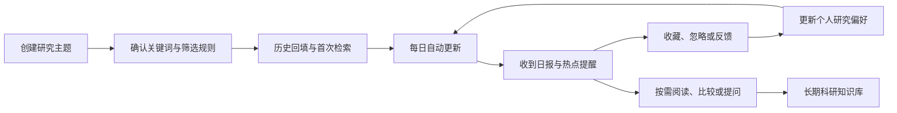
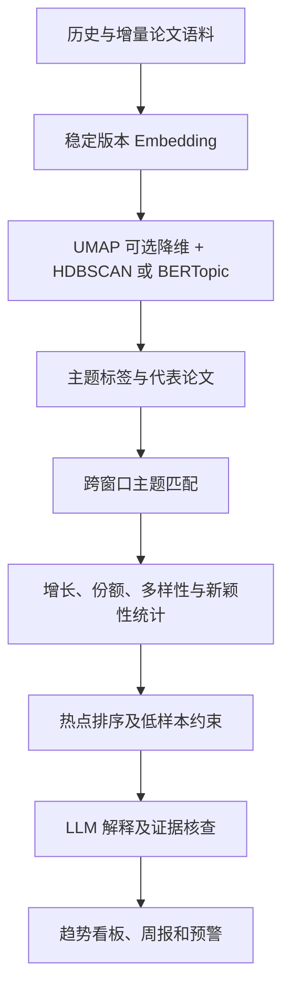
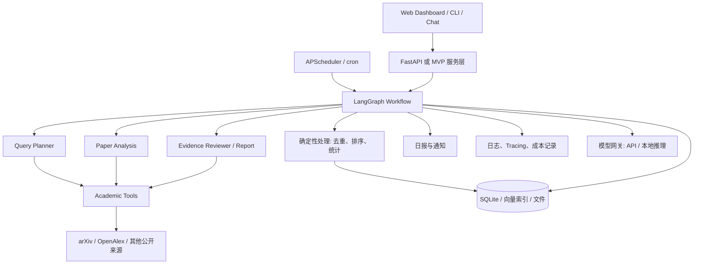
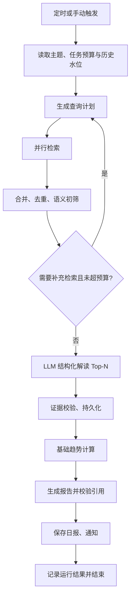

# ResearchRadar Agent：科研热点追踪与智能研究助手

**开发需求与技术路线方案（PRD + Technical Design）**

| 项目 | 内容 |
|---|---|
| 文档版本 | v1.0 |
| 文档日期 | 2026-11-26 |
| 项目名称 | ResearchRadar Agent（暂定） |
| 项目性质 | 面向个人科研人员的持续性科研情报 Agent |
| 开发模式 | 开源项目复现 → 独立 MVP → 模块化迭代 → 评估优化 |
| 目标用户 | 研究生、本科科研人员、科研工程师；第一版为单用户 |
| 首批领域 | 计算机视觉、工业异常检测、三维点云、LLM Agent（均可配置） |
| 部署方式 | 本地开发，常驻 Linux 服务器或定时云任务部署 |
| 核心技术 | Python、LangGraph、学术检索 API、Embedding、RAG、时序主题分析 |

> 本文为开发设计，不是已经实现的系统说明。时间、成本、算法权重和验收阈值均为拟定值，需要通过实测调整。默认先开发计算机科学领域的单用户版本，暂不训练大模型。

## 目录

- [1. 项目背景与目标](#1-项目背景与目标)
- [2. 产品范围与用户需求](#2-产品范围与用户需求)
- [3. 功能需求规格](#3-功能需求规格)
- [4. 科研热点发现技术路线](#4-科研热点发现技术路线)
- [5. Agent 架构与工作流](#5-agent-架构与工作流)
- [6. 数据源与数据处理](#6-数据源与数据处理)
- [7. 技术栈与开源项目复用](#7-技术栈与开源项目复用)
- [8. 数据模型与接口设计](#8-数据模型与接口设计)
- [9. 工程目录与部署](#9-工程目录与部署)
- [10. 评估测试与验收](#10-评估测试与验收)
- [11. 开发计划与资源预算](#11-开发计划与资源预算)
- [12. 风险、安全与维护](#12-风险安全与维护)
- [13. MVP 开发任务清单](#13-mvp-开发任务清单)
- [14. 参考资料](#14-参考资料)

---

## 1. 项目背景与目标

### 1.1 背景

科研人员需要持续追踪论文、会议、研究团队、代码仓库、数据集和技术趋势，但传统检索工具依赖主动查询，容易出现检索范围有限、重复阅读、信息过载、研究热点感知滞后等问题。通用 Deep Research Agent 虽然能够针对单个问题开展深度研究，却通常需要用户主动发起任务，不天然具备长期监控、历史积累与主动反馈机制。

ResearchRadar 的定位是 **Proactive Research Agent（主动式科研情报智能体）**：根据用户持续性的研究目标，定期获取科研信息，自主判断是否需要补充检索，分析相关性和证据，并将高价值结果沉淀为长期科研知识。

### 1.2 核心目标

1. **及时性**：每日自动获取关注方向的新论文、版本更新与重要科研事件。
2. **精准性**：结合语义检索、模型评分与用户反馈，筛选真正值得阅读的工作。
3. **趋势感知**：利用历史数据识别研究主题增长、衰退、新兴交叉方向，而不是由 LLM 主观判断热点。
4. **可追溯性**：所有推荐和研究结论都可以追溯到论文、数据来源及证据。
5. **长期积累**：形成个人文献库、研究兴趣画像、科研项目档案和历史趋势。
6. **自主性**：当证据不足或检索结果偏离目标时，Agent 能够调整查询、补充检索、选择阅读深度，并在预算内结束任务。
7. **开发学习价值**：通过实际项目掌握 Tool Calling、LangGraph、Memory、RAG、Context Engineering、Agent Evaluation、定时调度和工程部署。

### 1.3 与现有工具的区别

| 维度 | 普通学术检索 | Deep Research | ResearchRadar |
|---|---|---|---|
| 工作方式 | 用户主动搜索 | 单次问题驱动 | 每日运行 + 按需研究 |
| 数据范围 | 单平台为主 | 自主网页检索 | 多源学术信息与历史快照 |
| 信息积累 | 收藏为主 | 单次报告为主 | 长期结构化知识库 |
| 热点识别 | 搜索热度或排序 | 一次性归纳 | 时序统计与语义主题分析 |
| 个性化 | 关键词/推荐 | 当前任务 | 研究项目 + 用户反馈 |
| 交付形式 | 文献列表 | 深度报告 | 日报、周报、预警、问答 |

### 1.4 典型使用场景

- 用户订阅“3D Industrial Anomaly Detection”，每天收到新增高相关论文及其与当前研究的关联。
- 用户关注“大模型 Agent”，系统发现某类工具学习、记忆机制或 Agent 评估研究持续增长，生成热点预警。
- 用户正在开展几何先验与边界感知分割相关研究，系统提醒新论文、公开数据集及潜在相似方法，并给出可核实的证据。
- 用户询问“近三个月有哪些方法在 Real3D-AD 上开展实验”，系统从文献库检索并在必要时补充外部搜索，输出带来源的比较结果。

## 2. 产品范围与用户需求

### 2.1 优先级定义

- **P0 / MVP**：第一版必需，构成每天稳定运行的最小闭环。
- **P1 / V2**：强化科研情报能力与长期使用价值。
- **P2 / V3**：科研决策辅助与复杂 Agent 能力。

| ID | 需求 | 优先级 | 交付物 |
|---|---|---|---|
| FR-01 | 研究主题配置与管理 | P0 | 主题配置页/CLI |
| FR-02 | 多源增量文献检索 | P0 | arXiv + OpenAlex 适配器 |
| FR-03 | 跨源去重与版本识别 | P0 | 统一论文记录与来源关联 |
| FR-04 | 语义筛选、排序与推荐 | P0 | 每主题 Top-K 论文 |
| FR-05 | 结构化论文解读 | P0 | 摘要级论文卡片 |
| FR-06 | 自动日报与推送 | P0 | Markdown 日报 + 一种通知渠道 |
| FR-07 | 历史文献库与检索 | P0 | SQLite、筛选及收藏 |
| FR-08 | 定时任务、重试与运行记录 | P0 | 可恢复的每日任务 |
| FR-09 | 基础热点统计 | P0 | 7/30/90 日主题趋势 |
| FR-10 | 证据检查与成本控制 | P0 | 来源校验、预算与日志 |
| FR-11 | 全文阅读与证据提取 | P1 | PDF 章节、页码证据 |
| FR-12 | 动态语义热点发现 | P1 | 聚类、热点指数、主题演化 |
| FR-13 | 科研事件监控 | P1 | 会议、代码、数据集、论文版本事件 |
| FR-14 | 个性化反馈学习 | P1 | 相关性反馈、收藏/屏蔽 |
| FR-15 | 周报、月报及重要事件预警 | P1 | 综合趋势报告与告警 |
| FR-16 | 知识库 Agentic RAG 问答 | P1 | 带证据的多轮科研问答 |
| FR-17 | 论文比较与科研项目档案 | P2 | 方法对比、项目关联 |
| FR-18 | Research Gap 与创新性初步分析 | P2 | 候选研究问题及反向检索 |
| FR-19 | 实验方案辅助 | P2 | 数据集、基线、指标和消融建议 |
| FR-20 | MCP 与外部知识管理集成 | P2 | Zotero / MCP 工具适配 |

### 2.2 MVP 的明确边界

第一版实现一个主题创建后即可持续运行的完整闭环：主题配置 → 每日学术检索 → 去重 → 语义排序 → LLM 解读 → 基础热点统计 → 日报 → 保存与通知。

第一版不包含复杂多智能体集群、全领域学术数据库镜像、自动训练大模型、完整知识图谱、自动执行科研实验、商业级多租户、全量付费论文获取。MVP 只需一个 LangGraph 工作流及少量有界 LLM 决策节点，不要求七个独立 Agent。

### 2.3 用户工作流



## 3. 功能需求规格

### 3.1 研究主题与兴趣配置（FR-01）

用户可创建、暂停、修改、删除主题；配置关键词、排除词、学科类别、关注会议期刊、数据源、时区、运行频率、推荐数量、通知阈值与模型预算。主题可绑定若干代表论文以描述研究方向。

Agent 将自然语言研究目标转换为查询计划，生成同义词、缩写及相关交叉方向；初次扩展需用户确认，后续自动扩展限定在可审计范围内。查询词变更需记录版本，防止趋势统计口径悄然变化。

配置示例（拟定默认值）：

```yaml
id: industrial_3d_ad
name: 三维工业异常检测
description: 面向工业工件的点云及几何先验异常检测与分割
keywords:
  - 3D anomaly detection
  - point cloud anomaly segmentation
  - geometric prior
  - industrial inspection
exclude_keywords: [medical imaging]
venues_preferred: [CVPR, ICCV, ECCV, NeurIPS, ICLR, TPAMI]
sources: [arxiv, openalex]
timezone: Asia/Shanghai
schedule: '0 9 * * *'
lookback_days: 3
historical_backfill_days: 90
candidate_limit: 100
llm_analysis_limit: 15
report_top_k: 5
max_query_rounds: 2
max_run_minutes: 15
max_llm_calls: 25
notification_channel: local_report
```

验收：创建后可手动运行，支持暂停，重启后仍保留配置；两个主题的数据与推荐结果不会混淆。时区和时间可修改，不强制使用示例配置。

### 3.2 文献检索、去重及版本追踪（FR-02/03）

- 每日按主题执行查询，初次运行回填历史数据；后续以源级成功水位和回溯窗口执行增量同步。
- 同一篇论文可能同时出现在 arXiv、OpenAlex、Semantic Scholar 等平台；保留来源记录但只显示一个规范实体。
- arXiv v1/v2、期刊发表等变化记录为版本或关联事件，不直接当成全新论文重复推送。
- 区分发表时间、预印本提交时间、数据库更新时间、首次发现时间与本次获取时间。
- 部分数据源失败时输出部分结果及覆盖状态；不可将检索失败误报为当天无新论文。

验收：同一批数据重复执行不产生重复实体；任一源失败后可从上一次成功状态恢复；所有论文具备可访问的来源标识或明确的缺失状态。

### 3.3 论文智能推荐（FR-04）

使用多阶段筛选减少 LLM 调用成本：

1. 学术 API 召回并合并候选；
2. 精确去重、关键词排除及元数据过滤；
3. 标题和摘要 Embedding 与研究主题匹配；
4. 可选轻量 Reranker 对候选重新排序；
5. LLM 对排名前 N 篇进行结构化相关性评估、阅读价值解释；
6. 选择 Top-K 及少量探索性论文，避免推荐范围过窄。

MVP 排序初始规则（各项归一化）：

`score = 0.60 * relevance + 0.20 * recency + 0.10 * project_match + 0.10 * evidence_completeness`

其中 relevance 由语义相似度和 LLM 相关性判断组合得到，recency 使用一致的时间衰减函数，project_match 在用户未建立项目档案时按可用权重重新归一化，evidence_completeness 反映摘要、链接等字段是否完整，不代表论文质量。新颖性和研究质量第一版仅作有依据的定性提示，不使用 LLM 主观打分冒充同行评审。引用数、会议级别和作者知名度不能作为硬性排除条件。

V2 引入收藏/忽略反馈与多样性重排序（例如 MMR）。推荐日志保存评分分项、模型版本、查询版本及入选原因。用户可查看未推荐候选和修改阈值。

### 3.4 自动论文阅读与证据（FR-05/11）

| 等级 | 输入 | 输出 | 版本 |
|---|---|---|---|
| L1 | 标题、摘要、元数据 | 一句话总结、主题相关性 | MVP |
| L2 | 摘要、引言、结论 | 研究问题、方法、贡献、潜在关联 | V2 |
| L3 | 合法可访问的全文 | 技术细节、数据集、实验、局限性、证据位置 | V2 |

论文卡片至少包含：原始标题、作者、日期、发表状态（预印本/投稿/已录用/正式出版/未知）、链接、摘要级分析、推荐原因、阅读等级、证据引用、模型版本、更新时间。

全文分析额外提取数据集、训练协议、基线、指标、实验条件、代码链接、作者陈述的局限性以及 Agent 的独立分析。每个实验数字必须绑定证据；找不到的信息输出 `null` 或“原文未确认”，不得凭摘要编造。对于表格、图像或公式解析不完整的论文，标记需要人工核查。

推荐结构化输出契约（简化 JSON）：

```json
{
  "paper_id": "internal-id",
  "reading_level": "L1",
  "summary_zh": "论文摘要级概述",
  "problem": "研究问题或 null",
  "method": "方法描述或 null",
  "author_claims": ["作者在摘要中提出的贡献"],
  "agent_inferences": ["与用户主题的潜在关联"],
  "datasets": [],
  "metrics": [],
  "limitations": null,
  "evidence_ids": ["evidence-id"],
  "confidence": "medium"
}
```

### 3.5 科研日报、周报与通知（FR-06/15）

日报包含：主题与时间范围、来源覆盖及失败状态、候选/去重/相关数量、重点论文 3–5 篇、简要论文列表、基础趋势变化、重要事件以及原文链接。没有符合要求的论文时明确说明，不为凑数量降低筛选标准。

周报聚焦本周关键论文、热点变化、不同方法对比；月报进一步汇总领域演化、代表性工作及有证据支持的候选研究机会。报告采用 Markdown 存储，后续可扩展 HTML、PDF 或邮件格式。

高优先级提醒条件：与当前科研项目高度相关的论文、新的数据集或 Benchmark、代码/权重公开、会议官方公告、论文更正或撤稿、热点持续升温。设置事件级去重、每日上限和冷却周期，避免频繁通知。

MVP 先采用本地报告文件 + 可配置的一种 webhook 或 SMTP 渠道；通知失败独立重试，不重新运行昂贵的 LLM 分析。日报保存成功但推送失败须明确显示。

### 3.6 科研知识库与个性化（FR-07/14/16）

MVP 提供文献列表、关键词搜索、日期过滤、收藏及阅读状态。V2 增加 Embedding 向量索引、文档分块、元数据约束和 RAG 检索。

Agentic RAG 的决策规则：历史问题优先本地知识库；涉及最新研究或知识库证据不足时调用学术搜索；回答时同时说明检索范围、时间和引用。未命中不能证明某项研究不存在。

个性化画像由用户显式关键词、代表论文、收藏和忽略反馈构成。初版以规则更新为主，避免从单次操作推断稳定兴趣；允许用户重置或冻结画像。保留少量探索性推荐以减轻信息茧房。

### 3.7 科研项目档案、方法比较与 Research Gap（FR-17/18/19）

项目档案包括研究问题、当前方法、已完成实验、数据集、评价指标、预期贡献和代表文献。Agent 可将新论文与档案关联，提示潜在重合研究、可替代基线和新的实验资源。

论文比较必须区分数据集、划分、训练设置和评价协议，不直接混合不同设置下的指标。Research Gap 工作流采用“证据收集 → 候选问题生成 → 反向检索 → 证据审查 → 输出候选机会”的方法。结论需附相关与反例文献、检索范围及不确定性；不保证创新性或投稿结果。

## 4. 科研热点发现技术路线

### 4.1 基本原则

热点不能仅以最新论文、累计引用数或 LLM 印象表示。应建立可重复的统计分析，并将 LLM 用于解释数据、概括主题与提取代表论文。

**重要设计**：热点统计使用全部符合稳定主题检索口径的候选语料（经去重），不能只使用每天 Top-K 推荐结果，否则用户偏好、模型变化会导致趋势偏差。语料范围、来源覆盖和查询版本必须随统计结果保存。

### 4.2 MVP：固定子主题与滚动窗口

为每个研究主题定义少量可编辑的子方向，按关键词和 Embedding 规则将论文分配至子方向。允许多标签时，需要明确统计口径（论文计数可重叠，份额计算采用固定规则）。初始回填建议 90 天，窄领域可扩展至 180–365 天。

对每个子主题 k 统计：近 7 天、30 天、90 天的独立论文数、相邻等长窗口增长率、领域占比及代表性论文。以 30 天为主窗口，每日更新。论文数量按统一发表/首次预印本时间去重计数；若以首次发现时间统计，则单独标识，避免混用。

设最近窗口论文量为 `n_cur`、上一等长窗口为 `n_prev`，整个主题同期总量为 `N_cur`、`N_prev`：

```text
平滑增长：g = log((n_cur + 1) / (n_prev + 1))
份额变化：d = n_cur / max(N_cur, 1) - n_prev / max(N_prev, 1)
```

初始预警规则：最近 30 天至少 5 篇独立论文，平滑增长和领域份额同时上升，并连续两次周度评估满足阈值。具体阈值通过历史回放校准；小样本主题标记“证据不足”，不强行排名。对于未结束的时间窗口，按相同进度比较或等待窗口结束，避免把不完整月份当作下降。

### 4.3 V2：动态主题聚类与演化



1. 选用 BGE 等可本地运行的文本 Embedding 模型，固定模型及预处理版本；保存论文向量。
2. 采用 BERTopic/HDBSCAN 建立语义主题；样本不足时回退到固定主题统计。
3. 使用主题中心向量相似度、关键词重合率及共享论文识别跨窗口主题，记录新生、消亡、分裂、合并事件。避免把重新聚类后的标签 ID 当作同一主题。
4. 结合主题发文增长、领域份额、持续性、新颖性、独立团队数量和可用的开源信号。
5. 仅对满足覆盖和样本要求的主题计算热点指数；来源缺失时不以零值替代，降低置信度并重新归一化可用指标。

拟定指数：`H = 0.30*G + 0.20*V + 0.20*E + 0.15*P + 0.15*D`。G 为增长、V 为份额变化、E 为主题新兴程度、P 为增长持续性、D 为独立团队多样性，均以历史分布归一化至 0–1。代码活跃度、引用增长等作为额外辅助证据；新论文引用稀疏，不能作为必需指标。权重需通过回测验证。

### 4.4 评估与防偏差

- 采用历史时间切分：使用截至 t 的数据生成热点排名，用之后 30/90 天趋势及人工领域评价进行检验。
- 仅使用当时可获得的元数据；若回填数据库含未来收录、引用或修订信息，标注回测局限，避免数据泄漏。
- 比较固定关键词频数、滚动增长率、语义聚类与多信号融合四种方案。
- 衡量 Precision@K、提前量、误报率、主题稳定性，以及相对基线的改进。
- 查询词、数据源及 Embedding 版本变化时重新计算可比历史或分开显示统计系列。

## 5. Agent 架构与工作流

### 5.1 总体架构



原则：Agent 决策与确定性处理分离。数据清洗、计算、调度、权限、数据库写入、重试、通知发送使用普通代码；仅将真正需要语义理解、规划或证据判断的节点交给 LLM。

### 5.2 MVP 工作流



任务入口为 `run_daily(topic_id, as_of, run_id)`。查询规划器可以从配置和上次执行记录生成查询；补充检索由候选覆盖不足、主题偏移或证据缺失触发。没有论文并不必然需要反复查询。达到时间、调用、Token 或检索轮数预算后进入收尾节点。

### 5.3 职责划分

| 节点/Agent | 输入 | 输出 | 决策权限 |
|---|---|---|---|
| Query Planner | 主题、历史查询、覆盖信息 | 查询计划 | 选择已授权数据源、关键词扩展 |
| Search Tools | 查询计划、水位 | 标准化文献记录 | 无 LLM 自主权限；负责限流/重试 |
| Ranker | 论文与主题表示 | 排序、分项得分 | 确定性算法为主 |
| Paper Analysis | 论文、证据、主题 | 结构化论文卡片 | 选择允许的阅读层级 |
| Evidence Reviewer | 论文分析与来源 | 校验结果、缺失项 | 允许补充查询或降级输出 |
| Trend Engine | 规范语料、窗口 | 统计量、热点记录 | 确定性算法 |
| Report Writer | 已核验分析、趋势 | 日报 Markdown | 组织表达，不可创造来源 |
| Scheduler/Notifier | 任务计划、报告 | 状态、送达记录 | 确定性、幂等执行 |

V2/V3 才根据实际复杂度将 Search、Reading、Trend、Gap 等拆为独立子智能体。不要为了多 Agent 而多 Agent。

### 5.4 状态与工具契约

LangGraph 状态（概念定义）包括 `run_id, topic_id, as_of, topic_snapshot, query_plan, source_status, candidate_ids, selected_ids, evidence_ids, analysis_ids, trend_ids, budget_remaining, errors, report_id`。大型 PDF 和文本存储在外部文件/数据库，状态中只传引用，避免 Checkpoint 膨胀。

工具接口采用 Pydantic 输入输出模型，所有工具返回结构化成功/失败状态、来源、耗时、是否可重试。建议定义：

```text
search_papers(source, query, start, end, cursor) -> SearchPage
get_paper_metadata(source, external_id) -> PaperRecord
fetch_open_fulltext(paper_id) -> DocumentRef | Unavailable
rank_papers(topic_id, paper_ids, k) -> RankedPapers
analyze_paper(paper_id, level, evidence_ids) -> PaperAnalysis
get_trend(topic_id, window) -> TrendSnapshot
verify_citations(report_id) -> VerificationResult
```

MVP 采用函数工具；V2/V3 再暴露为 MCP Server，使工具可复用到其他 Agent。通知和外部写操作不提供给通用 LLM 自由调用。

### 5.5 自主性、记忆与调度边界

- 短期记忆：当前运行状态和工具结果；长期记忆：主题配置、文献库、反馈、历史报告。
- 自主决策限于查询扩展、补充检索、阅读深度、报告重点和证据检查。
- 调度器提供定时触发，不让 LLM 自己保持无限循环；限制同时运行的主题数和每次运行预算。
- 每次任务保存配置、Prompt、模型、数据源及算法版本，支持失败重试和复盘。
- 运行状态：`queued → running → succeeded / partial / failed / cancelled`。对同一主题、报告日期使用唯一任务键；失败重试复用任务与缓存，通知使用独立幂等键。

## 6. 数据源与数据处理

### 6.1 数据源接入计划

| 数据源 | 用途 | 接入方式 | 阶段 |
|---|---|---|---|
| arXiv | 最新预印本、版本变更 | API / RSS | MVP |
| OpenAlex | 跨领域论文、正式发表信息、机构与引用 | REST API | MVP |
| Semantic Scholar | 补充引用网络、相似论文与元数据 | Graph API | V2 |
| Crossref | DOI 与出版元数据校验 | REST API | V2 |
| OpenReview | 公开投稿、评审及会议录用状态 | API | V2 |
| CVF Open Access | 计算机视觉会议公开论文 | 官方页面 | V2 |
| GitHub | 论文代码仓库、发布与更新 | REST API | V2 |
| Hugging Face Hub | 模型、数据集与社区研究信息 | Hub API / 公开页面 | V2 |
| 官方会议/期刊/实验室 | CFP、录用名单与公告 | RSS 或许可的网页访问 | V2–V3 |
| Zotero | 用户个人文献与收藏 | Web API 或本地导出 | V3 |

首版不使用通用网页搜索作为唯一数据源。学术结构化 API 优先，网页搜索仅用于发现遗漏信息。各平台配额、认证要求、使用许可及查询语义可能变化，接入前以官方文档为准；未验证的访问方式不纳入硬性依赖。

### 6.2 增量同步与规范化

每个源适配器独立管理分页、超时、限流和水位。初次回填近 90 天，可按源分批执行，之后每天从最后成功水位减去默认 3 天回溯量开始查询。若数据源不能按更新时刻过滤，则使用其实际支持的时间字段，并定期执行较长回溯补偿。

单页获取后先保存规范记录和源记录，再提交进度。只有该源完整查询成功才推进成功水位，部分失败保留待补偿区间。候选上限命中时报告截断，不得声称已完整扫描全部文献；热点统计需要单独配置足够的分页预算。

跨源去重顺序：

1. DOI 规范化（去除 URL 前缀、统一大小写）。
2. arXiv ID 去除版本后缀，保留版本记录。
3. 已知跨源标识映射（OpenAlex、Semantic Scholar 等）。
4. 标题规范化 + 作者匹配 + 年份容差；对相似但不确定的记录保留为待核查关联，不直接合并。

论文规范记录保存来源优先级及字段来源。预印本和正式出版版本只有在有可靠标识或证据支持时才建立同一作品关联。修订、撤稿等事件以来源明确记录为准，不能仅因链接失效推断撤稿。

### 6.3 文档获取与知识库索引

仅下载公开且允许访问的全文。原始 PDF 与解析文本分离存储，记录 URL、内容哈希、获取时间、解析器版本、页码映射及许可信息。摘要不足时允许用户上传合法持有的文献；不绕过付费墙或访问限制。

V2 按章节分块，初始 chunk size 约 500–1000 tokens、适度重叠；针对表格与公式保留结构信息和原页链接。索引包含 paper_id、version_id、chunk_id、section、page、embedding_model_version。使用混合检索（关键词/FTS + 向量）并进行重排。索引可从数据库重建，不作为论文主数据的唯一存储。

## 7. 技术栈与开源项目复用

### 7.1 技术选型

| 模块 | MVP 选型 | 后续选型/升级条件 |
|---|---|---|
| 语言与依赖 | Python 3.11 或经依赖验证的版本，uv/venv + lockfile | 固定生产镜像与版本 |
| Agent 编排 | LangGraph | 复杂任务子图、自定义 Harness |
| LLM | OpenAI 兼容接口的模型网关 | 多供应商 / 本地模型路由 |
| 本地推理 | 非必需，Ollama 可选 | vLLM（并发或 GPU 服务） |
| 学术数据获取 | httpx、XML/JSON 解析 | 异步并行与缓存 |
| 数据模型 | Pydantic、SQLAlchemy | Alembic 迁移 |
| 数据库 | SQLite（WAL，单写入调度） | PostgreSQL |
| Embedding | sentence-transformers + BGE 或等价模型 | 学术领域模型对比 |
| 向量检索 | 小规模直接余弦相似度或 FAISS | pgvector/Qdrant |
| PDF | MVP 只读摘要 | PyMuPDF、Docling/MinerU |
| 调度 | APScheduler 或 cron（二选一） | Celery/Redis 等任务系统 |
| 前端 | Streamlit + Plotly | React/Next.js |
| 服务接口 | Python service/CLI，FastAPI 按需引入 | FastAPI + 前后端分离 |
| 主题统计 | pandas、scikit-learn | BERTopic、HDBSCAN |
| 通知 | 本地 Markdown + webhook/SMTP | 多渠道订阅 |
| 追踪 | Python logging + SQLite 运行记录 | Langfuse 或同类追踪 |
| 测试 | pytest、mock HTTP | CI、回归数据集 |
| 部署 | Docker Compose 或单机进程 | 按负载扩展 |

避免第一版同时引入多套框架、Redis、Kubernetes、独立向量数据库和复杂前后端。若 Streamlit 直接调用业务服务，不必先完成 FastAPI；调度任务必须与会话生命周期分离。

### 7.2 开源项目选择与改造方式

| 项目 | 主要价值 | 建议做法 |
|---|---|---|
| [ArxivDigest](https://github.com/AutoLLM/ArxivDigest) | 每日论文筛选与摘要 | 首选候选 Baseline；先验证仓库版本、依赖与许可，复现一条完整日报链路 |
| [paper_agent](https://github.com/HarborYuan/paper_agent) | 论文推荐与管理 | 参考评分和交互方式；不作为必要依赖 |
| [zotero-arxiv-daily](https://github.com/TideDra/zotero-arxiv-daily) | 个性化推荐与定时通知 | 参考研究画像、自动推送设计 |
| [LangGraph](https://github.com/langchain-ai/langgraph) | 可控状态图与条件分支 | 作为自主工作流编排基础 |
| [Open Deep Research](https://github.com/langchain-ai/open_deep_research) | 深度研究、子任务及信息压缩 | V2/V3 参考研究子图与证据管理 |
| [GPT Researcher](https://github.com/assafelovic/gpt-researcher) | 自主检索与报告生成 | 参考报告生成、检索与评审流程 |
| [BERTopic](https://github.com/MaartenGr/BERTopic) | 语义主题建模 | V2 热点分析模块 |
| [MCP Python SDK](https://github.com/modelcontextprotocol/python-sdk) | 工具与客户端标准接口 | V3 封装学术检索及本地知识库 |

复用原则：先建立独立小型 Baseline，再重构为自己的 ResearchRadar，而非拼装多个完整应用。首次复现时记录仓库 URL、Git commit、许可证、依赖版本、模型配置、输入和输出示例；如原项目不易部署或许可不适合，则依据公开接口独立实现最小检索和摘要模块。所有第三方代码复用需保留许可证要求的声明。

### 7.3 模型分工

| 任务 | 执行方式 |
|---|---|
| 去重、时间统计、阈值判断 | CPU 确定性代码 |
| Embedding、可选 Reranker | 本地 CPU/GPU 批处理 |
| 查询扩展、相关性评分、摘要 | 低成本模型或本地模型 |
| 全文精读、复杂研究问题 | 能力较强模型，按需调用 |
| 引用真实性与来源检查 | 程序校验 + 必要的 LLM 语义判断 |
| 聚类和热点统计 | CPU 为主，GPU 按规模选择 |

统一 ModelGateway，支持结构化输出、超时、重试、Token 统计与模型替换。缓存键应包含论文版本、任务类型、模型版本、Prompt 版本及主题版本。先使用可靠的 API 模型验证工作流，再对比本地模型；不将小模型推理失败直接归因于 Agent 架构。

## 8. 数据模型与接口设计

### 8.1 核心关系表

| 表 | 主键 / 关键字段 | 用途 |
|---|---|---|
| research_topics | id, config_json, version, enabled | 主题与调度配置 |
| papers | id, doi_norm, arxiv_base_id, title, abstract, published_at, status | 规范论文实体 |
| paper_sources | id, paper_id, source, external_id, url, fetched_at, raw_ref | 来源与原始记录 |
| paper_versions | id, paper_id, version_label, updated_at, content_hash | 版本历史 |
| topic_papers | topic_id, paper_id, first_seen_at, query_version | 主题与论文多对多关系 |
| paper_scores | topic_id, paper_id, score, components_json, model_version | 评分与推荐解释 |
| paper_analyses | id, paper_id, version_id, topic_id, level, result_json, prompt_version | 结构化解读 |
| paper_evidence | id, paper_id, version_id, source_id, page, section, excerpt | 引用证据 |
| source_sync | topic_id, source, query_version, watermark, status | 源级增量状态 |
| topic_clusters | id, topic_id, label, model_version, created_at | 语义/固定子主题 |
| trend_records | id, cluster_id, window_start, window_end, counts, scores_json, coverage | 趋势快照 |
| user_feedback | id, topic_id, paper_id, action, rating, created_at | 用户兴趣反馈 |
| research_reports | id, topic_id, report_type, period, path, run_id | 报告历史 |
| task_runs | id, topic_id, idempotency_key, status, budget_json, error_json | 运行状态与成本 |
| notifications | id, report_id, event_key, channel, status, attempts | 通知送达记录 |

MVP 先实现必要表（topics、papers、sources、versions、topic_papers、scores、analyses、evidence、source_sync、reports、runs、notifications 及简化趋势表）；语义聚类和反馈扩展可延后。数据库迁移需要版本化。

约束：`paper_sources(source, external_id)` 唯一；规范 DOI、arXiv ID 在确认合并规则后设置唯一约束；`topic_papers(topic_id, paper_id)` 唯一；任务和通知的幂等键唯一。时间以 UTC 存储，报告按用户配置时区展示。

### 8.2 服务 API（目标接口）

MVP 可先用同名 Python 服务函数与 CLI 实现，后续通过 FastAPI 暴露 HTTP。

| Method | Endpoint | 功能 |
|---|---|---|
| POST | /api/topics | 创建主题 |
| GET | /api/topics | 查看主题 |
| PATCH | /api/topics/{id} | 修改配置或暂停 |
| POST | /api/topics/{id}/runs | 手动运行（返回 run_id） |
| GET | /api/runs/{id} | 查询运行状态和错误 |
| GET | /api/papers?topic_id=&from=&to=&q= | 分页浏览论文 |
| GET | /api/papers/{id} | 论文卡片与证据 |
| POST | /api/papers/{id}/feedback | 收藏、忽略、评分 |
| GET | /api/topics/{id}/trends | 趋势记录 |
| GET | /api/reports?topic_id=&type= | 报告历史 |
| GET | /api/reports/{id} | 报告详情 |
| POST | /api/chat | V2 知识库问答 |
| POST | /api/research | V3 专题深度研究 |

统一错误格式：`code, message, retryable, request_id`。运行接口应异步返回任务 ID，不阻塞请求至日报完成；查询接口分页，按主题和日期过滤。单用户远程部署仍须身份认证，不公开匿名任务执行接口。

### 8.3 前端页面

- 首页：最新日报、重点推荐、最近运行状态、待阅读论文。
- 主题管理：新增、暂停、配置研究方向、确认查询扩展、手动运行。
- 文献库：按日期、来源、发表状态、相关度、收藏筛选；查看论文卡片及原文。
- 热点看板：子主题趋势曲线、增长及份额变化、代表性论文、数据覆盖提示。
- 报告中心：历史日报、周报、月报及 Markdown 导出。
- 运行中心：数据源状态、失败原因、耗时、Token、通知状态。
- V2/V3：知识库问答、项目档案、论文比较与研究空白专题页。

## 9. 工程目录与部署

### 9.1 目标目录结构

```text
ResearchRadar/
├── app/
│   ├── config/              # 配置、环境变量、主题模型
│   ├── schemas/             # Pydantic 输入输出模型
│   ├── sources/             # arxiv、openalex 等源适配器
│   ├── tools/               # Agent 工具接口
│   ├── agents/              # planner、reader、reviewer、writer
│   ├── workflows/           # daily、weekly、research 图
│   ├── retrieval/           # embedding、ranking、dedup、RAG
│   ├── analysis/            # trends、clustering、citation checks
│   ├── storage/             # ORM、repositories、migrations
│   ├── llm/                 # model gateway、缓存、预算
│   ├── scheduler/           # jobs、locks、retry
│   ├── notifications/       # report delivery、outbox
│   ├── prompts/             # 版本化 prompt
│   ├── services/            # 业务服务、运行入口
│   └── api/                 # 可选 FastAPI 接口
├── frontend/                # Streamlit，后续可替换
├── tests/                   # unit、integration、e2e
├── evaluation/              # 标注数据、baseline、回放脚本
├── scripts/                 # 初始化、回填、手动运行
├── docs/                    # PRD、设计、使用、复现说明
├── data/                    # 持久化目录，不提交私有数据
├── reports/                 # 日报/周报输出
├── pyproject.toml
├── uv.lock                  # 若选择 uv
├── .env.example
├── .gitignore
├── Dockerfile
├── compose.yaml
└── README.md
```

第一周只创建实际使用的模块；避免为尚未实现的 V3 功能搭建空泛框架。

### 9.2 部署与运行方式

开发环境：Python 虚拟环境 + SQLite + CLI/Streamlit。正式长期运行：单台常驻服务器，Docker Compose 运行 scheduler 与 UI（可选 API），挂载数据库和报告目录；或由独立 cron 每日执行 CLI。二者只选一种调度入口，避免重复触发。

第一版建议实现以下项目命令（设计契约，非现有可直接执行命令）：

```bash
# 初始化数据库
python -m app.cli init-db
# 历史回填
python -m app.cli backfill --topic industrial_3d_ad --days 90
# 手动运行日报
python -m app.cli run-daily --topic industrial_3d_ad
# 查看任务状态
python -m app.cli runs
# 启动常驻调度器（若采用 APScheduler）
python -m app.cli scheduler
# 启动界面
streamlit run frontend/app.py
```

配置使用 `.env`（API Key、模型、数据库路径、通知密钥）和主题 YAML。密钥不可写入报告、日志、Git 或 Agent 可自由读取的上下文。容器以非 root 用户运行，数据卷定期备份。

### 9.3 容错与可观测性

源级网络请求使用有界指数退避、抖动及限流，尊重 Retry-After 等响应；确定性错误不无限重试。LLM 结构化输出失败允许有限次修复，仍失败则输出降级摘要或跳过并记录。任务运行持久化进度；进程重启后检测陈旧锁并重新排队，使用幂等写入恢复。日报存储与通知解耦，避免推送失败触发整条流程重跑。

日志包含 run_id、topic_id、数据源、阶段、耗时、候选数量、成功/失败、模型/Prompt 版本、Token 与成本；不默认记录全文或敏感内容。仪表盘显示最近成功运行时间和积压状态。

## 10. 评估测试与验收

### 10.1 MVP 验收指标（拟定）

| 指标 | 目标 | 测量方式 |
|---|---|---|
| 检索召回率 | ≥90%（限定数据源、时间与标注集） | 与人工建立的相关文献集合比较 |
| Precision@10 | ≥80% | 人工标注推荐列表；不足 10 篇时另行报告实际数量 |
| 去重 Precision / Recall | 均 ≥95% | DOI/标题/版本混合标注集 |
| 结构化提取准确率 | ≥90% | 核对可由摘要或全文支持的字段 |
| 引用标识真实性 | 100% | ID 与来源记录匹配；不允许虚构论文链接 |
| 证据支持率 | ≥95% | 人工核查关键事实与证据对应性 |
| 日任务成功率 | ≥95% | 30 次可重复运行/模拟测试，正式运行另行统计 |
| 重复通知率 | ≤1% | 同批回放、失败重试及幂等性测试 |
| 单主题日常运行耗时 | ≤15 分钟 | ≤100 个候选、≤15 篇 LLM 分析，排除首次回填 |
| 成本可控 | 不超过用户配置预算 | 每次运行记录 Token、调用数与预算触发情况 |

召回率不可解释为整个互联网或全球科研成果的完整覆盖。提前设定评测样本与判定规则，避免在看到测试结果后修改评价口径。正式运行成功率需经过实际连续运行才能确认；部分成功单独统计，不能计为完全成功。

### 10.2 测试用例

| ID | 场景 | 预期结果 |
|---|---|---|
| T01 | 新建主题并首次运行 | 获取文献，生成含来源的报告 |
| T02 | 同一日、同一主题重复触发 | 不重复插入、不重复通知 |
| T03 | arXiv 与 OpenAlex 返回同一论文 | 一条规范实体、多条来源 |
| T04 | 论文 v2 更新 | 记录版本事件而非重复新论文 |
| T05 | 某源超时、限流 | 有界重试；未成功源水位不前移 |
| T06 | 所有源失败 | 标记失败，不输出虚假的“无新论文” |
| T07 | 无相关论文 | 合法空报告、注明覆盖和检索范围 |
| T08 | 模型输出不符合 schema | 修复或降级，记录错误 |
| T09 | 报告生成虚构引用 | 验证失败，移除或重新生成 |
| T10 | 中途进程重启 | 恢复或幂等重跑，不重复分析/通知 |
| T11 | 达到 Token/调用/时间预算 | 有界终止，报告部分结果 |
| T12 | 样本太少或来源覆盖异常 | 热点标记低置信度，不强行预警 |
| T13 | 用户暂停主题 | 不产生新计划任务 |
| T14 | 外部文档含恶意指令 | 仅视为数据，不触发越权工具 |
| T15 | 时区切换及跨日 | 报告日期与运行键符合配置 |

单元测试重点覆盖去重、分页、水位、排序、趋势公式、预算和 schema；集成测试使用固定 API 响应 fixture 和少量真实 smoke test；端到端测试从创建主题到报告保存与通知（测试渠道）。

### 10.3 对比实验设计

建议将开发过程设计为可复现的 Baseline 与增量实验，而非仅展示系统界面。

| 实验 | 方法 | 主要评价 |
|---|---|---|
| B0 | 固定关键词 + 按时间排序 | 检索召回、Precision@K |
| B1 | Embedding 排序 | 相关性提升与计算成本 |
| B2 | Embedding + Reranker | 排序改进 |
| A1 | B1/B2 + LLM 结构化评分 | 推荐质量、Token 成本 |
| A2 | A1 + Agent 查询扩展与补充检索 | 召回、多样性、检索成本 |
| A3 | A2 + 用户反馈 | 个性化准确性、探索覆盖 |
| H0 | 固定关键词增长率 | 热点检测基线 |
| H1 | 语义聚类 + 时序匹配 | 主题稳定性、热点提前量 |
| H2 | 多信号热点指数 | 热点质量、误报率 |

先选择 2–3 个主题、数个固定日期窗口，每主题人工标注约 50–100 篇候选作为初始评测集。严格复用同一候选集合比较排序方法；比较查询扩展时使用相同预算并明确检索语料差异。保存原始查询结果、Prompt、模型、随机种子、运行日志。该规模仅用于可行性验证，不足以支撑通用科研结论。

## 11. 开发计划与资源预算

### 11.1 第一阶段：7 天 MVP

| 日程 | 任务 | 当日产出 |
|---|---|---|
| Day 1 | 验证候选开源仓库、依赖、许可证；运行 ArxivDigest 或最小摘要流程 | Baseline 复现记录、首份报告 |
| Day 2 | 主题配置与 arXiv/OpenAlex 适配器 | 可测试的标准化检索接口 |
| Day 3 | SQLite、跨源去重、水位、历史回填 | 文献库及重复运行测试 |
| Day 4 | Embedding 排序、LLM 结构化分析、缓存 | 论文卡片与 Top-K 推荐 |
| Day 5 | LangGraph 状态图、补充检索、证据核查、预算 | 可手动运行的完整工作流 |
| Day 6 | 固定子主题统计、日报、定时任务与一种通知渠道 | 持续运行闭环 |
| Day 7 | Streamlit 最小界面、回归测试、部署文档 | 可演示、可使用的 MVP |

如果时间不足，先保住 arXiv、SQLite、相关性排序、日报、趋势和调度；OpenAlex 或 UI 可以在核心链路稳定后补齐，但未完成 P0 项前不能宣称完整 MVP 达标。

### 11.2 后续迭代

| 阶段 | 周期（累计） | 目标 |
|---|---|---|
| V1 | 第 1 周 | 每日论文追踪与基础趋势 |
| V2 | 第 2–3 周 | 更多数据源、全文阅读、动态主题、反馈、周报、RAG |
| V3 | 第 4–6 周 | 项目档案、论文比较、Research Gap、MCP、评估优化 |

周期是假设每日投入数小时的规划目标，不是交付承诺。建议每个阶段先达到可运行、可测量、可回滚的里程碑，再开始下一阶段。全文解析、热点回放和科研空白验证可能需要额外时间。

### 11.3 计算资源

| 方案 | 建议资源 | 用途 |
|---|---|---|
| API 模型 | 2–4 vCPU、8–16 GB RAM（开发起点） | MVP 单用户每日运行 |
| API + 本地 Embedding | 16 GB RAM，GPU 可选 | 推荐、历史回填 |
| 7B–8B 4-bit 本地模型 | 约 8–12 GB 显存起步 | 本地摘要和评分 |
| 14B 4-bit 本地模型 | 约 12–20 GB 显存 | 较复杂结构化分析 |
| 32B 4-bit 本地模型 | 约 24–40 GB 显存 | 高质量本地推理尝试 |

以上是粗略规划，不包含长上下文、高并发及额外模型的全部开销。MVP 不要求 GPU；优先复用已有 GPU 环境执行 Embedding/Reranker，再比较本地 LLM 的效果。持续运行需要在线主机，普通电脑关机后不会继续执行。

### 11.4 成本估算与预算机制

例：3 个主题，每主题每日分析 15 篇，每篇输入 3,000 tokens，输出 800 tokens，每月按 30 天计。每月约 405 万输入 tokens、108 万输出 tokens。

假设输入单价 3 元/百万 tokens、输出单价 12 元/百万 tokens，则单论文分析阶段月成本约 25.11 元。这只是示例价格，不是任何模型的当前报价；不包含查询规划、报告生成、补充检索、全文阅读、重试、服务器和付费数据源。实际模型价格和 API 配额以供应商为准。

控制策略：限制候选与 LLM 分析数量；只为新增或变更论文重新分析；摘要优先、全文按需；缓存相同输入；记录实际 Token；每主题设置调用次数、时间和费用上限；达到预算输出部分结果及原因。

## 12. 风险、安全与维护

| 风险 | 影响 | 应对 |
|---|---|---|
| 数据源限流或接口变化 | 漏检、任务失败 | 源适配器隔离、限流、回溯、fixture 回归测试 |
| 不同数据源收录偏差 | 热点失真 | 保存覆盖和查询版本，不将缺失视为零 |
| 模型幻觉与伪造引用 | 误导科研决策 | 结构化输出、真实 ID 白名单、证据验证 |
| 摘要信息不足 | 误读创新点或实验 | 明确阅读层级、未知字段、全文按需核查 |
| 查询扩展主题漂移 | 推荐失焦 | 用户确认、范围限制、对照基线 |
| 热点小样本与短期波动 | 假热点 | 最小样本、平滑、持续性和低置信提示 |
| 预印本与正式出版重复 | 虚增发文统计 | 规范实体、版本关系、证据合并 |
| 外部文档 Prompt Injection | 越权或数据泄露 | 外部内容仅作数据，工具白名单、权限隔离 |
| PDF 或 URL 不可信 | 恶意文件、SSRF | 下载域名/协议校验、限制体积、隔离解析、禁止访问私有网络 |
| API 密钥泄露 | 费用与隐私风险 | 环境变量/密钥管理，不写入日志和仓库 |
| 任务重复与通知骚扰 | 成本增加 | 唯一键、锁、outbox、频率限制 |
| 个人科研项目未公开信息 | 外部 API 泄露 | 最小化发送、可配置本地处理、显式授权 |
| 许可与版权 | 合规风险 | 仅使用授权数据，保留来源和许可证，控制原文存储与分发 |

维护要求：每日查看运行健康指标，定期核验数据源文档、预算及失败率；每周备份数据库和报告，测试恢复；更新模型、Prompt 或查询规则时保存版本并运行回归测试。对于研究建议明确标注证据范围与局限，不替代科研人员的专业判断。

## 13. MVP 开发任务清单

### Milestone 1：可运行 Baseline

- [ ] 核对 ArxivDigest（或替代项目）的仓库、许可、commit、运行依赖。
- [ ] 完成 Python 环境、模型 API 配置和一次真实论文检索。
- [ ] 保存 Baseline 输入、论文列表、报告和 Token 记录。
- [ ] 初始化独立 ResearchRadar 仓库、README、配置模板和测试目录。

### Milestone 2：数据基础

- [ ] 主题 Pydantic 配置与 CRUD。
- [ ] arXiv/OpenAlex 源适配器及固定响应测试。
- [ ] 规范论文模型、SQLite schema、唯一键与版本关系。
- [ ] 历史回填、增量水位、分页、限流、去重与失败补偿。

### Milestone 3：Agent 工作流

- [ ] Embedding 模型与排序基线。
- [ ] LLM 网关、结构化输出、缓存及预算。
- [ ] Query Planner、Paper Analysis、Evidence Reviewer 与 Report Writer。
- [ ] LangGraph 状态、条件分支、补充检索、终止条件与运行追踪。
- [ ] 论文卡片与来源、引用校验。

### Milestone 4：每日科研情报闭环

- [ ] 固定子主题和 7/30/90 日趋势统计。
- [ ] Markdown 日报、空报告与部分失败报告。
- [ ] 独立定时任务、锁、断点恢复和通知去重。
- [ ] Streamlit 主题、文献、热点和运行状态界面。
- [ ] 至少一种可配置通知渠道。

### Milestone 5：验收与部署

- [ ] 完成 T01–T15 中 MVP 对应的测试。
- [ ] 建立小规模人工标注评测集，记录 B0/B1/A1 初步指标。
- [ ] 连续运行/历史回放，验证幂等性、数据源失败及成本控制。
- [ ] 保存 Docker/单机部署说明、备份恢复说明与用户使用文档。
- [ ] 记录尚未达标的指标与已知限制，建立 V2 backlog。

**MVP 完成定义（Definition of Done）：**用户创建研究主题后，无需每天手动启动，系统在配置时间执行，能够检索并保存可核实的论文，产生带来源的推荐及趋势报告，成功推送或明确报告推送失败；数据源故障、无新论文、预算耗尽和重复执行均有可验证处理。只有实际测试通过的指标才标记为已达成。

## 14. 参考资料

以下为前期讨论确定的候选仓库与官方文档入口，用于实现前核对接口、许可和版本；本次文档整理未重新逐个安装项目或验证所有 API 的实时可用性。

### 学术数据源

- arXiv API: <https://info.arxiv.org/help/api/index.html>
- arXiv RSS: <https://info.arxiv.org/help/rss.html>
- OpenAlex API: <https://docs.openalex.org/>
- Semantic Scholar API: <https://www.semanticscholar.org/product/api>
- Crossref REST API: <https://www.crossref.org/documentation/retrieve-metadata/rest-api/>
- OpenReview: <https://docs.openreview.net/>
- CVF Open Access: <https://openaccess.thecvf.com/>
- GitHub REST API: <https://docs.github.com/en/rest>
- Hugging Face Hub: <https://huggingface.co/docs/huggingface_hub/>
- Zotero API: <https://www.zotero.org/support/dev/web_api/v3/start>

### 开源项目及技术资料

- ArxivDigest: <https://github.com/AutoLLM/ArxivDigest>
- paper_agent: <https://github.com/HarborYuan/paper_agent>
- zotero-arxiv-daily: <https://github.com/TideDra/zotero-arxiv-daily>
- LangGraph: <https://github.com/langchain-ai/langgraph>
- Open Deep Research: <https://github.com/langchain-ai/open_deep_research>
- GPT Researcher: <https://github.com/assafelovic/gpt-researcher>
- BERTopic: <https://github.com/MaartenGr/BERTopic>
- FlagEmbedding: <https://github.com/FlagOpen/FlagEmbedding>
- FAISS: <https://github.com/facebookresearch/faiss>
- MCP Python SDK: <https://github.com/modelcontextprotocol/python-sdk>
- APScheduler: <https://apscheduler.readthedocs.io/>
- FastAPI: <https://fastapi.tiangolo.com/>
- Streamlit: <https://docs.streamlit.io/>

---

## 总结

ResearchRadar 的优先目标是解决真实科研信息追踪需求，而不是构造一个形式复杂的多智能体系统。最有效的开发路径是：

**复现每日论文推荐 Baseline → 自主实现增量检索与持久化 → 引入有界 Agent 工作流 → 建立日常推送闭环 → 完善统计和语义热点识别 → 增加知识库与科研决策辅助。**

先做一个每天都能可靠使用的系统，再以明确的指标和对比实验持续提高它的智能化程度。
